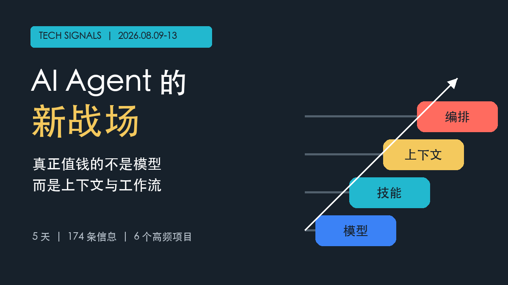
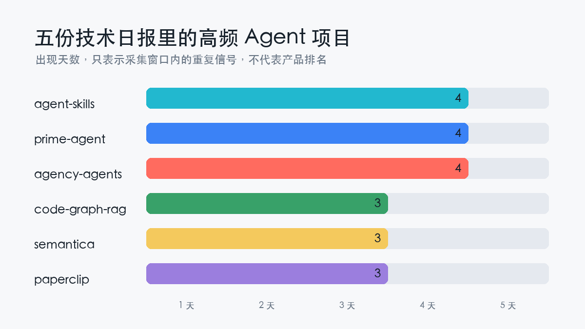
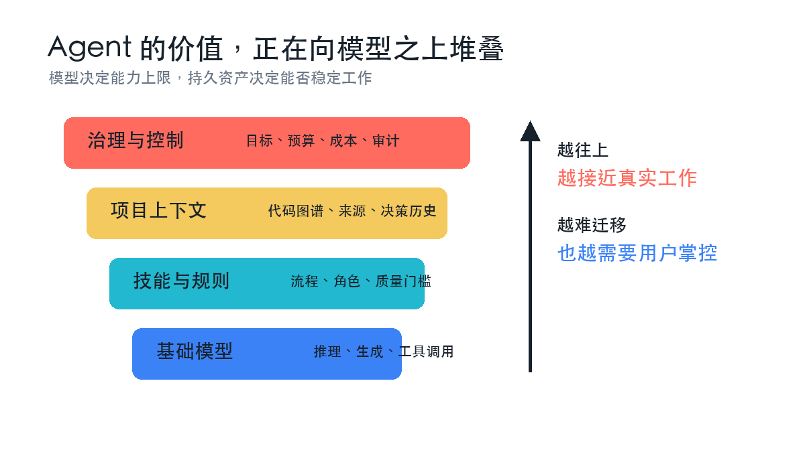
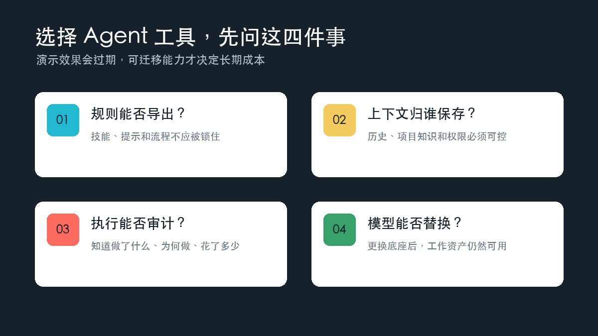

# AI Agent 的新战场：真正值钱的不是模型，而是你的工作方式

从 8 月 9 日到 13 日，五份技术日报共收录 174 条信息，其中 74 条来自 GitHub。真正值得注意的不是又出现了多少个 Agent 项目，而是同一批项目连续登榜：`agent-skills`、`prime-agent`、`agency-agents` 各出现 4 天，`code-graph-rag`、`semantica`、`paperclip` 各出现 3 天。

五天的窗口当然不能证明行业胜负，却暴露出一个清晰变化：AI Agent 的竞争，正在从“谁的模型回答更聪明”，转向“谁能保存并执行一套稳定的工作方式”。

## 从会回答，到能持续工作

[agent-skills](https://github.com/addyosmani/agent-skills) 把工程流程和质量门槛封装成可复用技能；[prime-agent](https://github.com/PrimeIntellect-ai/prime-agent) 强调编码与长期自主任务；[agency-agents](https://github.com/msitarzewski/agency-agents) 则把角色、流程和交付物写进专业 Agent 定义。它们解决的都不是“再训练一个更大的模型”，而是让现有模型按规则反复完成工作。

这很像企业招聘。聪明只是入场券，真正决定产出的，是岗位说明、历史经验、协作流程和验收标准。模型可以替换，但这些积累不会自动跟着迁移。

## 上下文正在变成基础设施

另外三个高频项目进一步补齐了这套结构。[code-graph-rag](https://github.com/vitali87/code-graph-rag) 把代码库解析成可查询的知识图谱；[semantica](https://github.com/semantica-agi/semantica) 强调上下文、来源追踪与可审计决策；[paperclip](https://github.com/paperclipai/paperclip) 则管理 Agent 的目标、任务、预算和成本。

这意味着，Agent 真正进入工作场景后，难题不再只是生成答案，而是四件更朴素的事：它知道什么、为什么这么做、花了多少钱、出了问题能否追溯。模型能力决定上限，上下文与控制层决定它能不能长期使用。

但资产越丰富，治理成本也越高。技能文件可能带着执行权限，代码图谱可能包含敏感信息，长期记忆还可能保存错误判断。所谓“用户掌控”不能只等于一键导出，还应包括权限隔离、版本记录和随时撤销。Agent 基础设施成熟的标志，不是让它无限自主，而是让每一次自主都可检查、可中止、可恢复。

## 选择工具时，先问能否带走资产

8 月 13 日的技术日报还收录了一篇关于 AI 编程工具迁移的 36Kr 报道。报道最有价值的观察，不是哪一家工具占了上风，而是用户开始把配置、技能、插件和历史上下文视为“数字家当”。一旦这些资产无法导出，换工具的真实成本就远高于订阅费。

因此，普通用户和团队选择 Agent 产品时，不妨少看一次演示跑分，多问四个问题：规则能否导出？上下文是否由自己保存？执行过程能否审计？能否替换底层模型？

过去，AI 产品争夺的是入口；下一阶段，它们争夺的将是用户积累下来的工作方式。真正可靠的选择，不是把自己锁进最强模型，而是确保模型更换之后，你的经验仍然属于你。

## 公开来源

- [2026-08-13：36Kr 关于 AI 编程工具迁移成本的报道](https://www.36kr.com/p/3936454072663429)
- [agent-skills](https://github.com/addyosmani/agent-skills)、[prime-agent](https://github.com/PrimeIntellect-ai/prime-agent)、[agency-agents](https://github.com/msitarzewski/agency-agents)
- [code-graph-rag](https://github.com/vitali87/code-graph-rag)、[semantica](https://github.com/semantica-agi/semantica)、[paperclip](https://github.com/paperclipai/paperclip)
