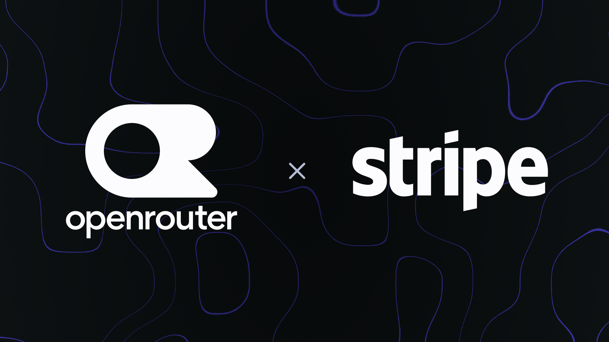
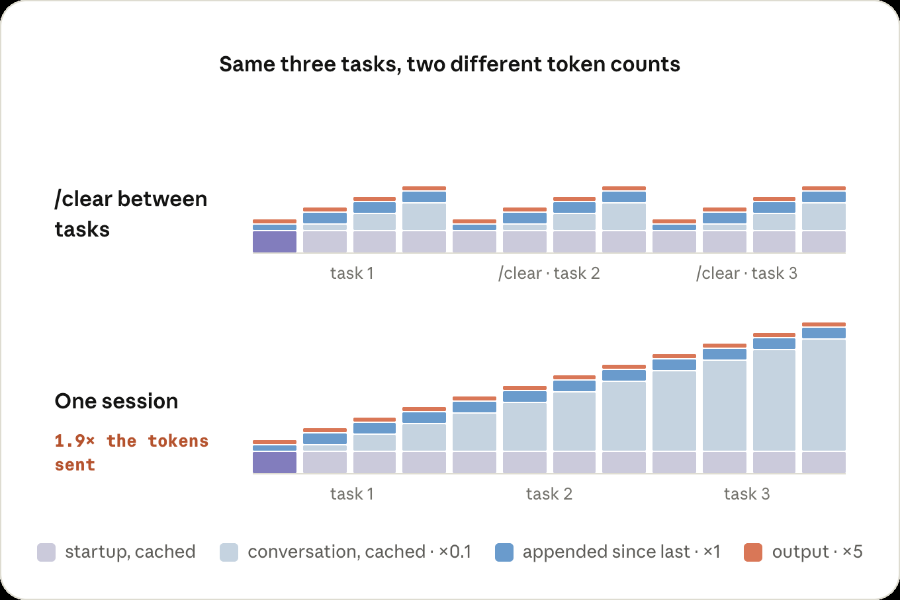
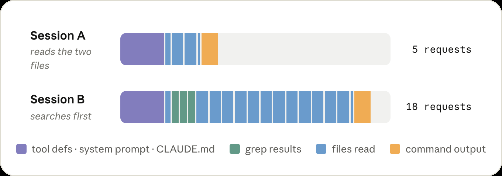
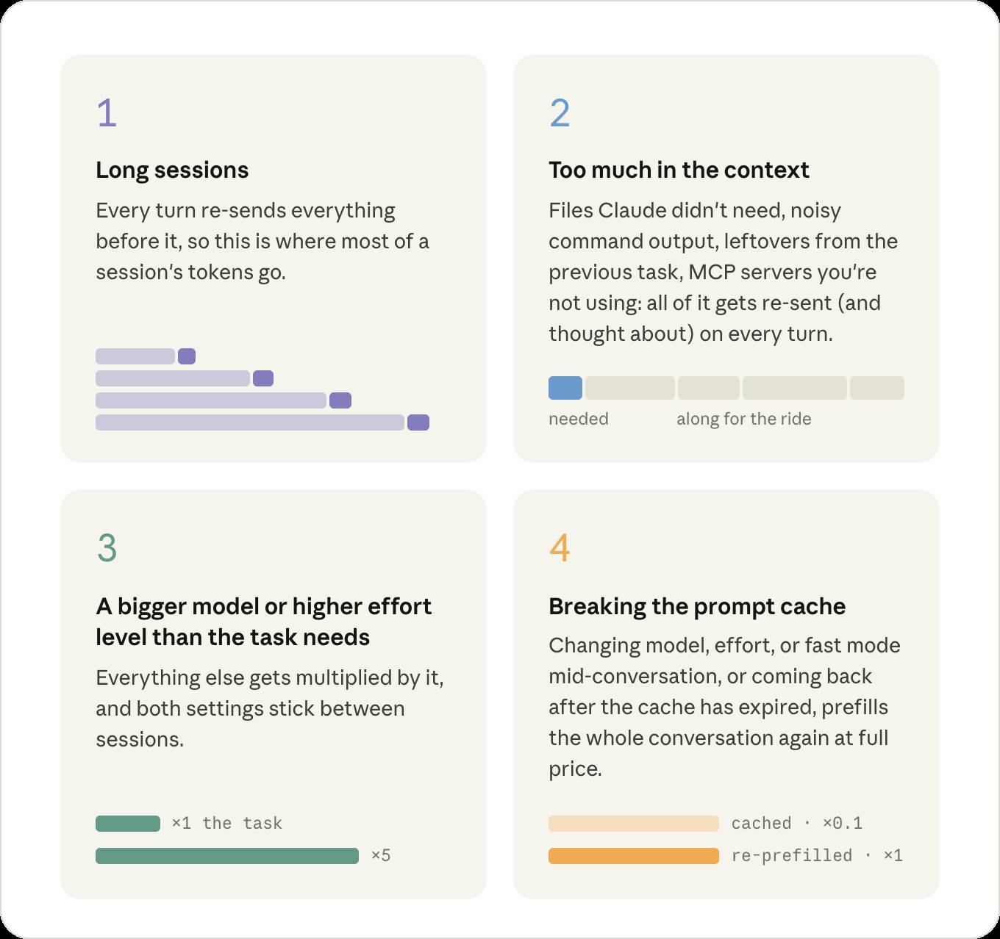

# Stripe 买下 OpenRouter：模型外面那一层，已经标上了天价

8 月 16 日，这笔交易还只是传闻。3 天后，OpenRouter 官方宣布将加入 Stripe。《纽约时报》报道对价约 75 亿美元；三个月前，它的 B 轮估值还是 13 亿美元。Stripe 没有公布价格。OpenRouter 自己的说法是：每天处理超过 10 万亿 token，接入 400 多个模型，服务超过 1000 万开发者。

从 8 月 16 日到 21 日的技术日报里，这是最清楚的信号：AI 开始被明码标价的，不再只是模型，而是模型前面的路由、计量和账单。

## 同一项任务，花费可以差一个数量级

8 月 14 日，Anthropic 官方提醒：Claude Code 同样的工作，token 花费可以差出一个数量级。提示缓存命中时，输入按 0.1 倍计价；任务结束就该 `/clear`，免得上一份文件和命令输出继续占上下文；中途换模型或推理强度，缓存会失效，历史按全价重算。

彭博社引述知情人士称，Anthropic 到 7 月底的年化经常性收入已达 650 亿美元，公司拒绝置评。一边是模型公司把智力卖得很贵，一边是官方承认：很多钱其实烧在了垃圾上下文上。

## 用户在买“少花一点”，也在买一层外壳

同一窗口里，开源项目也在围着账单转。[caveman](https://github.com/JuliusBrussee/caveman) 在一份钉死的 Claude Code 对照实验中报告，输入 token 减少 33.2%，18 个任务质量未降；文档写明这不是生产环境统计。8 月 19 日，[DeepSeek Harness](https://github.com/deepseek-ai/deepseek-harness) 发布 rc.8，README 把公式写成 Model + Harness = Agent；对更新说明的整理显示，可以把 Claude Code 和 Codex 装成子代理。[llmfit](https://github.com/AlexsJones/llmfit) 则帮人在自己的电脑上挑能跑的本地模型——这是另一条逃路：不走云端账单。

这很像支付业的分工。银行管账户，Stripe 管收款；模型管生成，网关和调度层管走哪家、花多少、失败了换谁。对普通用户来说，每月付的钱越来越不像“买一个更聪明的大脑”，而像水电费：用多少、走哪条管道、有没有漏掉，都会出现在账单上。

边界也必须说清。Caveman 的数字来自受控基准，独立讨论还质疑过它更早的输出压缩宣传。星标不能证明生产效果。OpenRouter 加入 Stripe 后，中立路由仍是承诺，交易也尚未完成。本地模型目前证明的是“能跑”，不是“同样质量更便宜”。

选择 AI 工具时，可以少问一次模型强不强，多问三件事：账单由谁计量？换模型会不会把工作流一起锁死？会话和缓存能不能被你清掉？模型还会继续变贵。真正开始被买走的，是管住这笔账单的那一层。

## 公开来源

- [OpenRouter 加入 Stripe 的官方说明](https://openrouter.ai/blog/announcements/openrouter-is-joining-stripe/)
- [TechCrunch 对交易确认与《纽约时报》报价的报道](https://techcrunch.com/2026/08/19/stripe-confirms-its-acquiring-ai-model-marketplace-openrouter/)
- [Anthropic：如何提高 Claude Code 会话价值](https://claude.com/blog/maximizing-the-value-of-your-claude-code-sessions)
- [彭博社关于 Anthropic 年化经常性收入的报道](https://www.bloomberg.com/news/articles/2026-08-17/anthropic-hits-65-billion-in-annualized-revenue-as-usage-soars)
- [caveman](https://github.com/JuliusBrussee/caveman)、[DeepSeek Harness](https://github.com/deepseek-ai/deepseek-harness)、[llmfit](https://github.com/AlexsJones/llmfit)
- [rc.8 更新说明的第三方整理](https://www.mindstudio.ai/blog/deepseek-harness-rc8-native-vision-claude-code-codex-subagents-concurrent-web-search/)
- 配图来源：OpenRouter 公告正文图；Anthropic 官方文章正文图（非封面 OG）。商标归原权利人。
